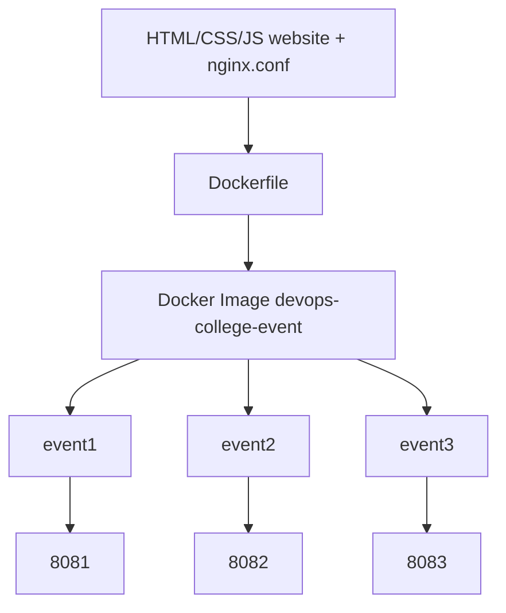

# College Event Website Deployment Using Docker and Nginx

**Project:** CampusConnect — College Events & Fest (static website served by Nginx in Docker)

## 1. Abstract
A responsive college event website (HTML, CSS, JavaScript) is packaged into one Docker image with Nginx. Three containers are started from that single image on host ports 8081, 8082 and 8083. A custom `nginx.conf` serves the site and a custom `404.html` page.

## 2. Problem Statement
A website that works on one computer may fail on another because of different software and settings. Docker packages the site and its server together so it runs the same everywhere.

## 3. Objectives
1. Create a Docker image with a Dockerfile.
2. Serve a static website with Nginx.
3. Configure Nginx with a custom `nginx.conf`.
4. Show a custom 404 page.
5. Run three containers from one image on ports 8081, 8082, 8083.

## 4. Technologies Used
HTML5, CSS3, vanilla JavaScript, Docker, Nginx (`nginx:alpine`), PowerShell, VS Code.

## 5. System Requirements
- Windows 10/11 (64-bit), virtualization enabled in BIOS
- Docker Desktop with WSL 2 backend
- 4 GB RAM minimum, a web browser, VS Code (optional)

## 6. Project Folder Structure
```
devops-college-event/
├── Dockerfile
├── nginx.conf
├── .dockerignore
├── README.md
└── site/
    ├── index.html
    ├── events.html
    ├── about.html
    ├── contact.html
    ├── login.html
    ├── register.html
    ├── 404.html
    ├── css/style.css
    ├── js/script.js
    └── assets/images/
```

## 7. Website Features
- Pages: Home, Events, About, Contact, Login, Register, custom 404
- Login and Register pages are frontend-only demos: forms are validated in the browser, no accounts exist, nothing is stored
- Responsive layout and mobile menu
- Event cards with category filter and search
- Register button shows a demo pop-up (nothing is saved)
- Contact form with validation and demo success message (nothing is sent)
- Sample data only; events and contacts are fictional

## 8. Dockerfile Explanation
| Instruction | Meaning |
|---|---|
| `FROM nginx:alpine` | Start from a small Alpine Linux image that already has Nginx |
| `RUN rm -rf /usr/share/nginx/html/*` | Delete Nginx's default page |
| `COPY site/ /usr/share/nginx/html/` | Put our website in Nginx's web folder |
| `COPY nginx.conf /etc/nginx/conf.d/default.conf` | Replace default server settings with ours |
| `EXPOSE 80` | Documents that the container uses port 80 |

No `CMD` is needed: the base image already starts Nginx.

## 9. Nginx Configuration Explanation
| Line | Meaning |
|---|---|
| `listen 80;` | Listen on container port 80 |
| `root /usr/share/nginx/html;` | Folder with the website files |
| `index index.html;` | Default file for `/` |
| `autoindex off;` | No folder listings |
| `try_files $uri $uri/ =404;` | Serve the file if it exists, else return 404 |
| `error_page 404 /404.html;` | Show our custom page for missing files |
| `error_page 403 =404 /404.html;` | Folder without index shows 404 page too |
| `location = /404.html { try_files $uri =404; }` | Serves the error page as a normal file, so there is no redirect loop |

## 10. Step-by-Step Installation (Windows)
1. **Enable virtualization:** Task Manager > Performance > CPU > "Virtualization: Enabled".
2. **Install WSL 2** (PowerShell as Administrator), then restart:
   ```powershell
   wsl --install
   ```
3. **Install Docker Desktop** from https://www.docker.com/products/docker-desktop/ (keep "Use WSL 2" ticked), restart, and open Docker Desktop. Wait until it says "Engine running".
4. **Check Docker:**
   ```powershell
   docker --version
   docker info
   ```
   If `docker info` shows an error about the daemon, Docker Desktop is not running yet.
5. **Open the project in VS Code:**
   ```powershell
   cd C:\path\to\devops-college-event
   code .
   ```
   (or VS Code > File > Open Folder).

## 11. Build the Image
```powershell
docker build -t devops-college-event .
```
`-t` gives the image a name. The `.` means "use the Dockerfile in this folder". Run it inside the `devops-college-event` folder.

## 12. Run Three Containers (same image)
```powershell
docker run -d --name event1 -p 8081:80 devops-college-event
docker run -d --name event2 -p 8082:80 devops-college-event
docker run -d --name event3 -p 8083:80 devops-college-event
```
`-d` runs in background, `--name` names the container, `-p HOST:CONTAINER` maps a laptop port to the container port.
**Host ports differ (8081, 8082, 8083); the container port is always 80.** Each container is isolated, so they do not clash.

## 13. Test URLs
- http://localhost:8081
- http://localhost:8082
- http://localhost:8083

All three show the same website.

## 14. Test the Custom 404 Page
Open http://localhost:8081/nothing-here (or any missing page). The styled 404 page appears. PowerShell check:
```powershell
curl.exe -I http://localhost:8081/nothing-here
```
Expected first line: `HTTP/1.1 404 Not Found`.

## 15. Useful Commands
| Command | What it does |
|---|---|
| `docker --version` | Shows the Docker version |
| `docker images` | Lists images on your laptop |
| `docker ps` | Lists running containers |
| `docker ps -a` | Lists all containers, including stopped |
| `docker logs event1` | Shows Nginx logs of `event1` |
| `docker stop event1` | Stops `event1` |
| `docker start event1` | Starts `event1` again |
| `docker rm -f event1 event2 event3` | Force-removes the three containers |

Optional check of the Nginx config inside a running container: `docker exec event1 nginx -t`

## 16. Troubleshooting
| Problem | Fix |
|---|---|
| `docker` not recognized | Install Docker Desktop, then reopen PowerShell |
| "Cannot connect to the Docker daemon" / "error during connect" | Start Docker Desktop and wait for "Engine running" |
| WSL 2 error | Run `wsl --update` as Administrator, restart |
| Virtualization disabled | Enable it in BIOS (Intel VT-x / AMD-V) |
| "port is already allocated" | Another program uses the port. Use `docker ps`, remove the old container, or choose another host port |
| "container name already in use" | `docker rm -f event1` and run again |
| "failed to read dockerfile" | You are in the wrong folder. `cd` into `devops-college-event` |
| Page does not load | `docker ps` to confirm it is Up, then `docker logs event1` |
| Old website after editing files | Rebuild the image, remove containers, run them again |

## 17. Expected Output
- `docker images` lists `devops-college-event`.
- `docker ps` lists `event1`, `event2`, `event3` with ports `0.0.0.0:8081->80/tcp`, `8082->80/tcp`, `8083->80/tcp`.
- Three browser tabs show CampusConnect.
- A missing URL shows the custom 404 page.

## 18. Conclusion
The project shows how Docker packages a static site and Nginx into one image, and how many identical containers can run from it. This gives consistent, repeatable deployment. Limitations: static content only, no HTTPS or database, and containers must be rebuilt for each content change.

---

## Architecture
```
 HTML / CSS / JavaScript website (site/)
              |
          Dockerfile
              |
   Docker Image: devops-college-event
        /        |        \
      C1         C2         C3
   (event1)   (event2)   (event3)
      |          |          |
    8081       8082       8083     (host ports -> container port 80)
```



---

## Viva Questions and Answers
1. **What is Docker?** A tool that packages an application and what it needs into containers.
2. **What is an image?** A read-only template containing the app, files and settings.
3. **What is a container?** A running instance of an image.
4. **Image vs container?** Image = recipe/blueprint; container = the running thing made from it. One image can make many containers.
5. **What is a Dockerfile?** A text file with instructions to build an image.
6. **What is a base image?** The starting image your image builds on (here `nginx:alpine`).
7. **Why `nginx:alpine`?** It has Nginx and uses the very small Alpine Linux, so it downloads and starts fast.
8. **What is Nginx?** A fast web server that serves files over HTTP.
9. **What is a static website?** A site of fixed HTML, CSS and JS files with no backend or database.
10. **What does `docker build -t devops-college-event .` do?** Builds an image named `devops-college-event` from the Dockerfile in the current folder.
11. **What does `docker run` do?** Creates and starts a container from an image.
12. **What does `-d` mean?** Detached: run in the background.
13. **What does `-p 8081:80` mean?** Send traffic from host port 8081 to container port 80.
14. **Why different host ports?** One host port can serve only one program. Different ports let three containers run together.
15. **Why is the container port always 80?** Nginx inside each container listens on 80; containers are isolated, so each has its own port 80.
16. **What is container isolation?** Each container has its own filesystem, network and processes, separate from the others.
17. **What is HTTP and port 80?** HTTP is the protocol for web pages; 80 is its default port.
18. **What does `COPY` do in the Dockerfile?** Copies files from your laptop into the image.
19. **What does `EXPOSE 80` do?** Documents the container port. It does not publish it; `-p` does.
20. **What is a custom 404 page?** Our own styled page shown when a URL does not exist, set by `error_page 404 /404.html;`.
21. **How do you prevent directory listing?** `autoindex off;` in `nginx.conf`.
22. **How does Docker give consistent deployment?** The image holds the same files and server settings, so every container behaves the same on any machine.
23. **What happens if you stop `event1`?** Only `event1` goes down; `event2` and `event3` keep working.
24. **How do you see running containers?** `docker ps`.
25. **Benefits of this project?** Easy, repeatable, portable deployment; quick to scale.
26. **Limitations?** Static content only, no HTTPS, no database, rebuild needed after changes, and demo forms store nothing.

---

## Practical Demonstration Script
1. **Introduce:** "My project deploys a college event website using Docker and Nginx and runs it as three containers from one image."
2. **Show files:** Open the folder in VS Code; point out `site/`, `Dockerfile`, `nginx.conf`.
3. **Dockerfile:** "FROM picks Nginx on Alpine, COPY adds the site and my config, EXPOSE documents port 80."
4. **Nginx config:** "It listens on 80, serves `/usr/share/nginx/html`, blocks directory listing, and shows `404.html` for missing pages."
5. **Build:** `docker build -t devops-college-event .`
6. **Show image:** `docker images`
7. **Start three containers:** the three `docker run` commands in section 12.
8. **Show them:** `docker ps`
9. **Open URLs:** localhost:8081, 8082, 8083.
10. **404 demo:** open `localhost:8081/missing`.
11. **Stop one:** `docker stop event2`; refresh 8082 (fails), 8081 and 8083 still work.
12. **Restart:** `docker start event2`; refresh 8082.
13. **Conclude:** "An image is the blueprint; a container is a running copy. One image gave me three identical containers."

**Cleanup after the exam:** `docker rm -f event1 event2 event3`
